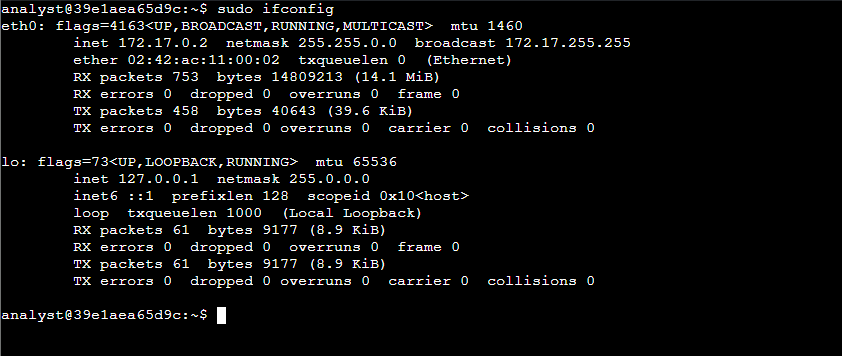
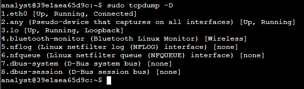
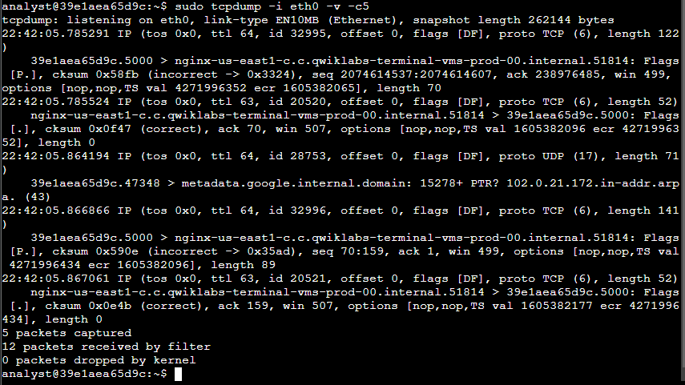
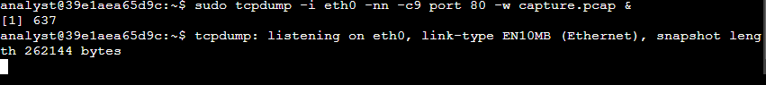
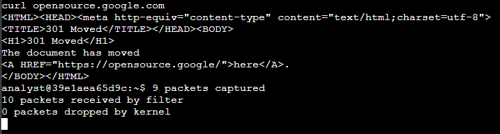
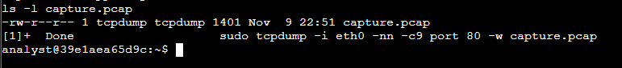
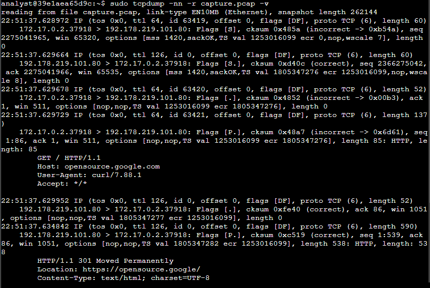
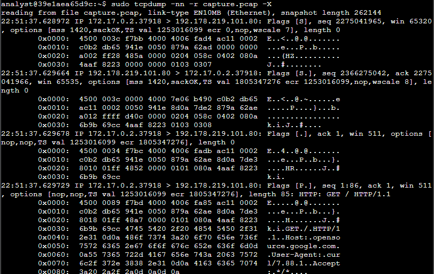

# tcpdump Packet Capture

## Summary
A guided course lab where I used tcpdump on a Linux virtual machine to find the available network interfaces, inspect live traffic, save a filtered capture of web (TCP port 80) traffic to a `.pcap` file, and then read that file back in verbose and hex/ASCII formats.

> Part of my [Incident Response Journal](https://github.com/john-danko-cyber/incident-response-journal) (Entry 3), which collects all my Detection and Response course labs.

## My Role
I worked in the course's Linux lab VM as the `analyst` user. I ran every command, generated the HTTP traffic with curl, read and interpreted the output, and took the screenshots in this repo. The lab environment was provided by the course, and the only traffic captured was the lab VM's own.

## Project Overview

This project documents a tcpdump packet capture lab from the Google Cybersecurity Certificate (Sound the Alarm: Detection and Response). The goal was to capture and filter network traffic from the command line, the way an analyst would on a Linux server without a graphical tool like Wireshark.

---

## Scenario

As a network analyst, I needed to use tcpdump to capture and analyze live network traffic from a Linux virtual machine. The work had four steps: identify network interfaces, inspect live traffic on an interface, capture traffic to a file, and filter the captured packet data.

---

## Tools Used

- **tcpdump** (command-line packet analyzer)
- **ifconfig** (network interface configuration)
- **curl** (used to generate HTTP traffic)
- Linux Bash shell

---

## Commands Used

| Command | Purpose |
|---|---|
| `sudo ifconfig` | List network interfaces and their addresses |
| `sudo tcpdump -D` | List the interfaces tcpdump can capture on |
| `sudo tcpdump -i eth0 -v -c5` | Capture 5 live packets on `eth0` with verbose detail |
| `sudo tcpdump -i eth0 -nn -c9 port 80 -w capture.pcap &` | Capture 9 port 80 packets to a file in the background, with no name lookups |
| `curl opensource.google.com` | Generate HTTP traffic to capture |
| `ls -l capture.pcap` | Confirm the capture file was written |
| `sudo tcpdump -nn -r capture.pcap -v` | Read the saved capture with verbose header detail |
| `sudo tcpdump -nn -r capture.pcap -X` | Read the saved capture in hex and ASCII |

---

## Key Findings

- **Interfaces:** `ifconfig` showed `eth0` (172.17.0.2, MAC 02:42:ac:11:00:02) and the loopback `lo` (127.0.0.1). `tcpdump -D` listed 8 capture options, with `eth0` first as Up, Running, Connected, so `eth0` was used for capture.
- **Live capture:** The 5 packets captured on `eth0` were mostly TCP between the VM on port 5000 and the lab's nginx host, showing push and ACK flags (`[P.]`), plus one UDP DNS reverse (PTR) lookup to the metadata server. tcpdump resolved IP addresses to hostnames by default.
- **Saved capture:** The background capture finished with 9 packets captured and 0 dropped, and `capture.pcap` was saved at 1,401 bytes. The curl request returned a `301 Moved` page pointing to `https://opensource.google/`.
- **TCP handshake:** Reading the file showed the full three-way handshake between 172.17.0.2:37918 and 192.178.219.101:80: SYN (`[S]`), SYN-ACK (`[S.]`), then ACK (`[.]`).
- **HTTP exchange:** The client sent `GET / HTTP/1.1` with `Host: opensource.google.com` and `User-Agent: curl/7.88.1`, and the server replied `HTTP/1.1 301 Moved Permanently` with `Location: https://opensource.google/`.
- **TTL:** Outbound packets from the VM had a TTL of 64, while replies from the web server arrived with a TTL of 126.
- **Hex/ASCII view:** With `-X`, the HTTP request text (`GET / HTTP/1.1`, the Host header, and the curl User-Agent) was readable directly in the packet bytes, and each IPv4 header started with `45`, meaning IPv4 with a 20-byte header.

---

## Screenshots

### 1. Network interfaces (`sudo ifconfig`)

### 2. Interfaces available to tcpdump (`sudo tcpdump -D`)

### 3. Live capture on eth0 (`sudo tcpdump -i eth0 -v -c5`)

### 4. Background capture of port 80 traffic to a file

### 5. curl request and capture completion

### 6. Capture file saved (`ls -l capture.pcap`)

### 7. Reading the capture with verbose output (`-nn -r capture.pcap -v`)

### 8. Reading the capture in hex and ASCII (`-nn -r capture.pcap -X`)

---

## Skills Demonstrated

- Identifying network interfaces with `ifconfig` and `tcpdump -D`
- Capturing live traffic on a specific interface with packet count and verbosity options
- Applying a capture filter (`port 80`) and writing packets to a `.pcap` file
- Reading saved captures and interpreting IP and TCP header fields (TTL, flags, sequence and acknowledgment numbers, length)
- Recognizing a TCP three-way handshake and an HTTP request and response
- Reading packet contents in hexadecimal and ASCII

---

## What I Learned

- `-nn` turns off IP and port name lookups, which keeps output accurate and avoids tipping off an attacker through DNS lookups during an investigation.
- `-w` saves packets for later analysis, and `-r` reads them back, so a capture can be reviewed or shared without capturing again.
- TCP flags tell the story of a connection: `S` starts it, `S.` answers, `.` acknowledges, and `P.` pushes data.
- The HTTP User-Agent header shows which tool made a request, in this case curl rather than a web browser.
- Hex and ASCII output lets an analyst see the raw bytes of a packet, which is useful for spotting patterns in malware or forensic analysis.

---

## Disclaimer

Guided course lab from the Google Cybersecurity Professional Certificate (Coursera), completed in a course-provided Linux VM. Only the lab VM's own traffic was captured; no outside network was monitored. The write-up is my own.

## Certificate
Google Cybersecurity Certificate — Sound the Alarm: Detection and Response
